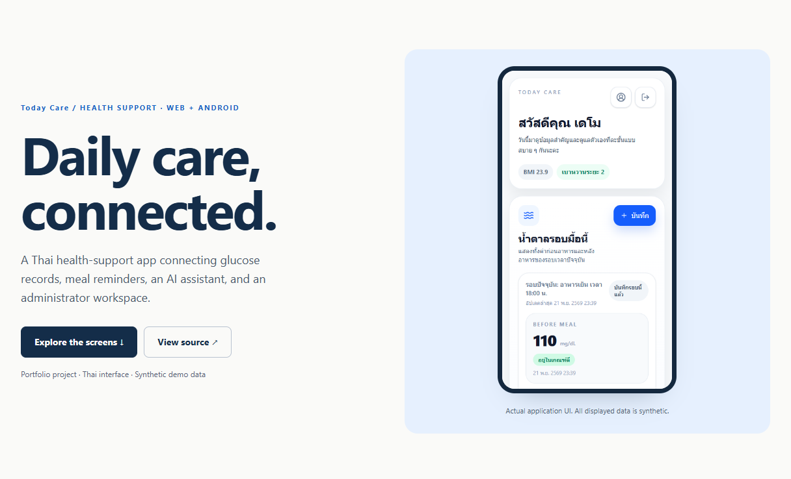
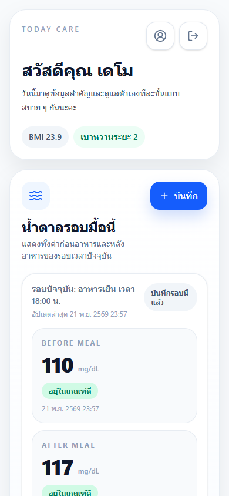
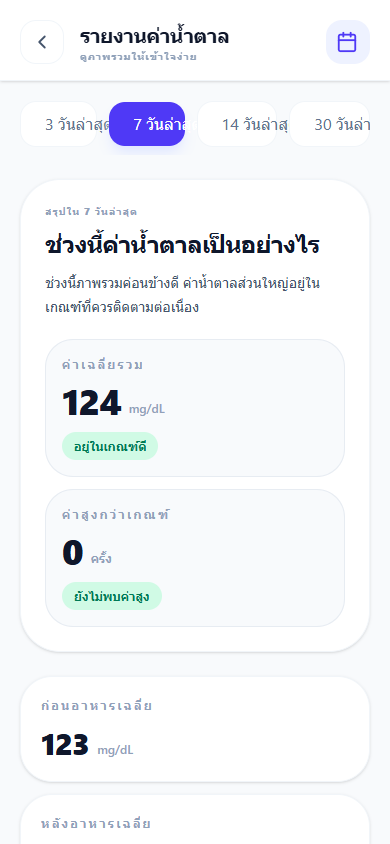
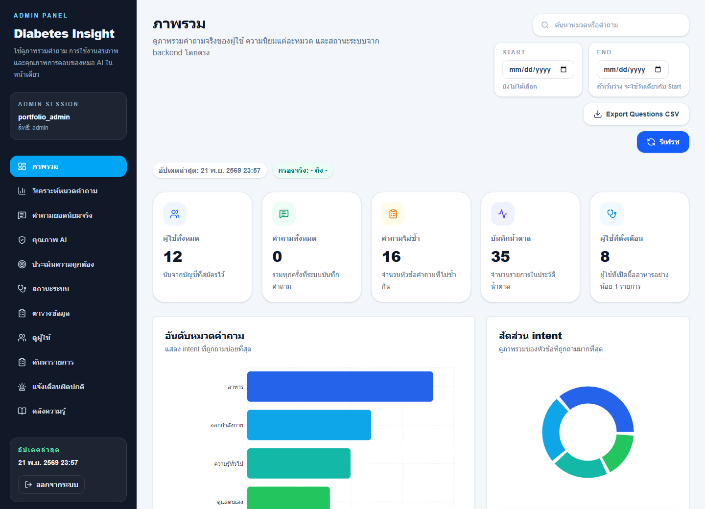
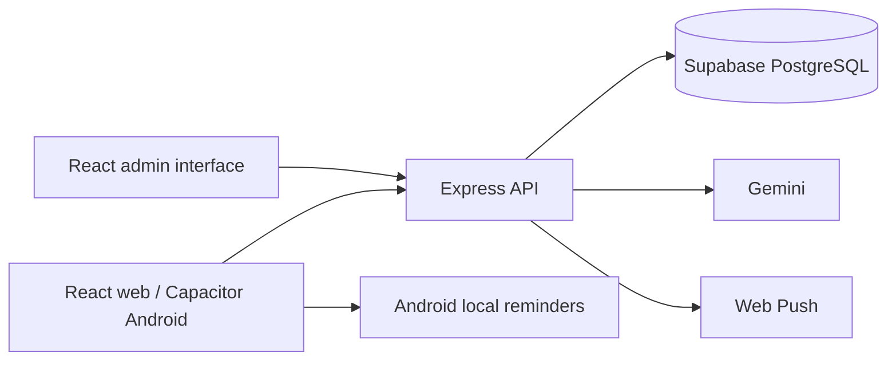

# Today Care — Diabetes Care AI

A Thai health-support web and Android application for glucose logging, meal reminders, educational chat, and administrator review.

[Explore the case study](https://today-care-case-study.vercel.app) · [View demo screens](#demo-screens) · [Read the engineering review](REVIEW.md)



> Portfolio project. Demo screens use synthetic data. AI responses support education and do not replace medical advice, diagnosis, or treatment. No clinical effectiveness or real-world health outcome is claimed.

## What the project demonstrates

- A connected frontend, Express API, and Supabase PostgreSQL database.
- Mobile-oriented React screens with a Capacitor Android shell.
- Glucose logging, history, trend summaries, and meal reminder settings.
- Gemini-powered educational chat with health-context support.
- A separate admin interface for usage, records, knowledge content, and response evaluation.
- Signed HttpOnly session cookies, authenticated routes, and verified database TLS.

## Demo screens

| Daily dashboard | Glucose summary |
|---|---|
|  |  |



## Demonstration assets

Screenshots were captured from local production builds with intercepted synthetic API responses on 21 November 2026. Names, records, project data, and dashboard totals are fixtures. They are not production usage metrics. The case-study gallery presents actual application UI and does not grant access to a live operational database.

The [interactive case study](https://today-care-case-study.vercel.app) includes screen selection and full-size image viewing. A [Markdown version](portfolio/CASE_STUDY.md) is also available on GitHub. The public presentation is separate from the authenticated application.

## Tech stack

| Layer | Technologies |
|---|---|
| User frontend | React, Vite, Tailwind CSS, Recharts |
| Admin frontend | React, Vite, Recharts |
| Backend | Node.js, Express |
| Database | Supabase PostgreSQL |
| AI | Google Gemini through the Google Gen AI SDK |
| Android | Capacitor, native local notifications |
| Web notifications | Web Push |
| Verification | Node test runner, GitHub Actions |

## Architecture



Database credentials and AI/notification secrets stay on the server. The application uses its own sessions; Supabase supplies PostgreSQL.

## Repository structure

```text
frontend/        # User-facing React application
admin-panel/     # Administrator interface
backend/         # Express API, database access, security tests and evaluation tools
android/         # Capacitor Android shell
docs/            # Architecture, API, setup and development notes
portfolio/       # Case study source and approved synthetic screenshots
```

## Run locally

Use Node.js 22 and your own isolated test database. Install the root dependencies first because the frontend imports Capacitor packages from the root project:

```bash
npm ci
npm --prefix backend ci
npm --prefix frontend ci
npm --prefix admin-panel ci
```

Copy `backend/.env.example` to `backend/.env` and configure your test database, session/admin secrets, and any required providers. Review the frontend/admin environment examples; the user frontend uses `VITE_API_URL`.

```bash
npm --prefix backend run db:check
npm run dev:backend
# In separate terminals:
npm run dev:frontend
npm --prefix admin-panel run dev
```

The user frontend normally runs at `http://localhost:5173`; the API health endpoint is `http://localhost:5000/api/health`. Use the actual URL printed by Vite for the admin app.

The public Supabase root CA is bundled in `backend/certs`. Remote database connections require verified TLS; `PGSSL_CA` can override the trust bundle for another provider or a CA rotation. List the exact production web/admin/native origins in `ALLOWED_ORIGINS`.

## Checks and evidence

```bash
npm --prefix backend test
npm --prefix frontend run build
npm --prefix admin-panel run build
```

| Check | Recorded result |
|---|---|
| Security regression tests | 8 passed |
| User and admin production builds | Passed |
| Database connectivity | Read-only SELECT 1 passed with encryption and certificate verification |
| Android notifications | Previously tested successfully, as confirmed by the project owner |

The database check does not establish full API persistence or replace isolated integration tests. Android was not reinstalled during this review. Repeat relevant device checks when app/notification code changes. See [REVIEW.md](REVIEW.md) for evidence boundaries and remaining work.

## Android workflow

With the Android development tools installed:

```bash
npm run build:app
npm run android:open
```

See the [Android build guide](docs/ANDROID_APP_BUILD.md).

## Documentation

- [Case study](portfolio/CASE_STUDY.md)
- [System architecture](docs/SYSTEM_ARCHITECTURE.md)
- [API reference](docs/API_DOCUMENTATION.md)
- [Database schema](docs/DATABASE_SCHEMA.md)
- [Setup and configuration](docs/SETUP_CONFIGURATION.md)
- [Source code guide](docs/SOURCE_CODE_GUIDE.md)
- [Dataset and evaluation guide](docs/DATASET_GUIDE.md)
- [Known issues and roadmap](docs/KNOWN_ISSUES_AND_ROADMAP.md)
- [Railway backend deployment](docs/RAILWAY_BACKEND_DEPLOY.md)
- [Vercel frontend deployment](docs/VERCEL_DEPLOY.md)

Keep populated environment files, health data exports, private keys, and provider credentials outside Git. Demonstrate health-related features using synthetic data.
