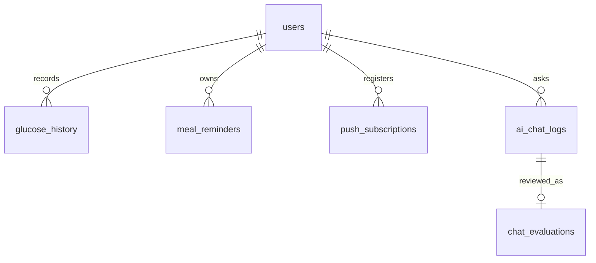

# Database Schema

ฐานข้อมูลเป็น Supabase Postgres และ backend จะสร้าง/ปรับตารางที่จำเป็นเมื่อเริ่มทำงาน ดู source of truth ที่ `backend/database.js`.

| ตาราง | คีย์/ความสัมพันธ์ | วัตถุประสงค์ |
| --- | --- | --- |
| `users` | `id` PK, `username` UNIQUE | บัญชีและข้อมูลสุขภาพ เช่น BMI, ระยะโรค, การแพ้ยา |
| `glucose_history` | `user_id` → `users.id` | ค่าน้ำตาล ช่วงการวัด วันที่ เวลา และเวลาที่บันทึก |
| `meal_reminders` | `user_id` → `users.id`; UNIQUE `(user_id, reminder_key)` | เวลาการเตือนมื้ออาหารต่อผู้ใช้ |
| `push_subscriptions` | `user_id` → `users.id`; `endpoint` UNIQUE | Web Push subscription และ keys |
| `ai_chat_logs` | `user_id` → `users.id` (SET NULL เมื่อผู้ใช้ถูกลบ) | คำถาม, intent, โมเดล และสถานะ fallback |
| `chat_evaluations` | `chat_log_id` PK → `ai_chat_logs.id` | การตรวจ intent และหมายเหตุจากแอดมิน |
| `question_stats` | `question_text` UNIQUE | สถิติคำถามในรูปแบบเดิม/รองรับ migration |
| `knowledge_entries` | `id` PK | ฐานความรู้ที่แอดมินจัดการให้ AI ใช้ |

## Indexes และประสิทธิภาพ

- Primary key และ unique constraints สร้าง index อัตโนมัติ เช่น `users.username`, `push_subscriptions.endpoint`
- API อ่านประวัติน้ำตาลด้วย `user_id` และเรียง `recorded_at`; เมื่อข้อมูลเพิ่มมาก ให้เพิ่ม composite index `(user_id, recorded_at DESC)`
- Analytics อ่าน `ai_chat_logs` ตามช่วงเวลา/intent; แนะนำ index `(created_at, intent_key)` เมื่อปริมาณข้อมูลสูง
- รักษา foreign keys และ `ON DELETE` behavior ตาม schema เพื่อไม่ให้เกิดข้อมูลกำพร้า

## ความปลอดภัยของข้อมูล

รหัสผ่านผู้ใช้เก็บเป็น hash (`scrypt`) ไม่เก็บ plaintext. Connection string ของฐานข้อมูลอยู่ใน `SUPABASE_DB_URL` หรือ `DATABASE_URL` เท่านั้น.

> หมายเหตุ: API แบบประเมินใช้ตาราง `satisfaction_surveys` แต่ตารางนี้ไม่ได้ถูกสร้างใน `backend/database.js` ปัจจุบัน จึงต้องสร้างผ่าน migration ก่อนเปิดใช้ในฐานข้อมูลใหม่.
