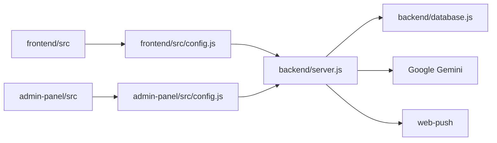

# Source Code Guide

เอกสารนี้เป็นแผนที่ source code สำหรับนักพัฒนาที่รับช่วงต่อ โดยให้เริ่มจากไฟล์ที่เป็น source of truth ด้านล่าง

## Entry points

| พื้นที่ | Entry point | ความรับผิดชอบ |
| --- | --- | --- |
| User frontend | `frontend/src/main.jsx`, `frontend/src/App.jsx` | Bootstrap React, session restoration และ app-style navigation |
| Admin frontend | `admin-panel/src/main.jsx`, `admin-panel/src/App.jsx` | Admin authentication และ dashboard/management views |
| Backend | `backend/server.js` | Express routes, auth, AI chat, reminders และ admin APIs |
| Database | `backend/database.js` | Postgres connection และ schema initialization |
| Android | `capacitor.config.ts`, `android/` | Capacitor WebView shell และ native Android project |

## Module map

### Frontend (`frontend/src`)

- `components/` — หน้า login, register, dashboard, chat, report, profile และ reminder UI
- `data/` — quick prompts, categories และ static presentation data
- `utils/` — validation, browser helpers และ `nativeNotifications.js`
- `config.js` — อ่าน `VITE_API_URL`; อย่า hard-code production URL ใน component

### Admin panel (`admin-panel/src`)

- `components/` — cards, charts, user/record/knowledge/evaluation management
- `config.js` — กำหนด API base URL ของ admin panel
- ต้องเรียก `/api/admin/*` พร้อม admin session cookie

### Backend (`backend`)

- `server.js` — route handlers และ validation; ใช้เป็น API contract หลัก
- `database.js` — `pg` pool, placeholder conversion และ idempotent schema changes
- `adminAnalytics.js` — SQL/query helpers สำหรับ analytics และ CSV exports
- `scripts/migrate-sqlite-to-postgres.js` — migration จาก SQLite เดิม
- `scripts/generate-evaluation-benchmark.js` — สร้าง benchmark แบบ deterministic
- `scripts/run-real-benchmark.js` — ส่ง benchmark ไปยัง API ที่กำลังรันและสรุป metrics

## กติกาเมื่อแก้โค้ด

1. แก้ API route พร้อมอัปเดต `API_DOCUMENTATION.md`
2. แก้ schema ด้วย migration ที่ idempotent และอัปเดต `DATABASE_SCHEMA.md`
3. เปลี่ยน environment variable ให้แก้ `.env.example` และ `SETUP_CONFIGURATION.md`
4. อย่าแก้ไฟล์ใน `dist/`, `build/`, `node_modules/` หรือ generated result เพื่อแทน source code
5. ตรวจ frontend build และ `/api/health` ก่อน merge/deploy
