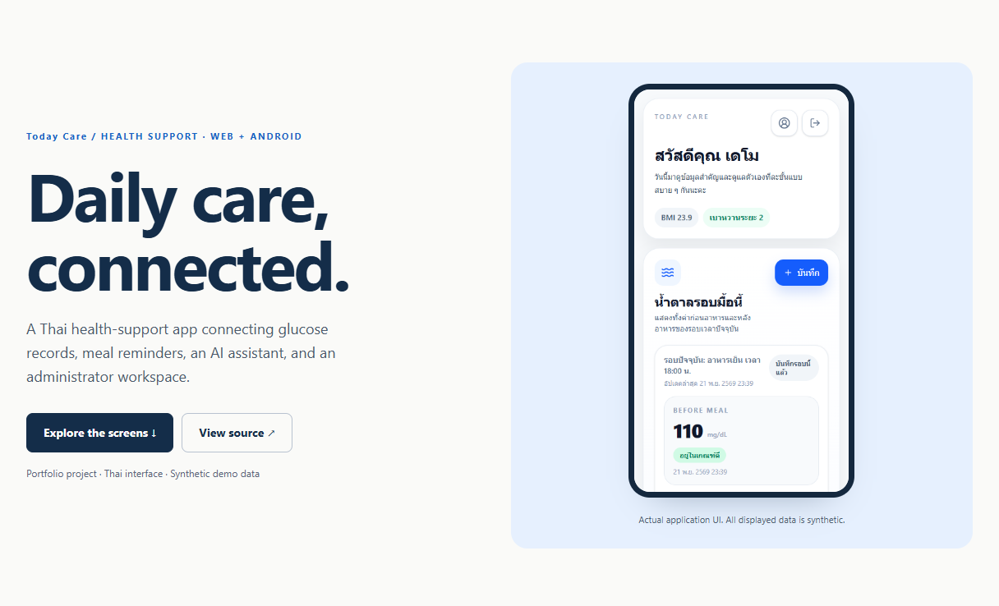
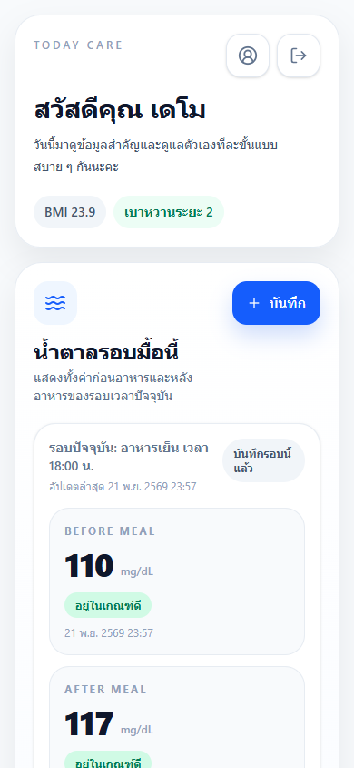
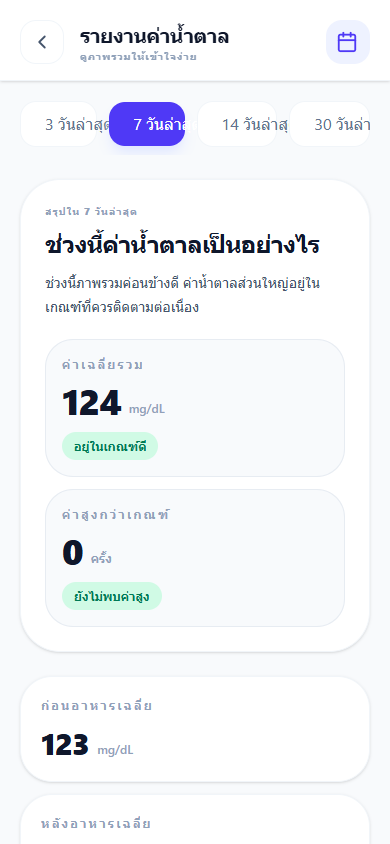
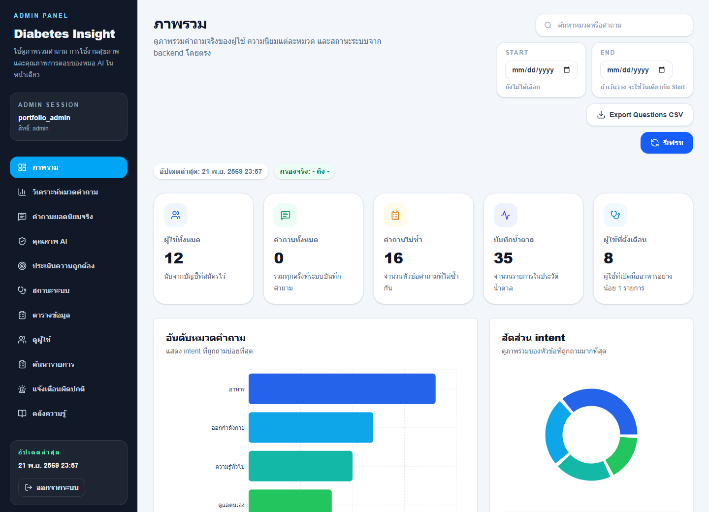

# Today Care — Full-stack Case Study

[Open the interactive presentation](https://today-care-case-study.vercel.app) · [Source repository](../README.md)

## Problem

Connect daily glucose records, reminder settings, and educational chat in a mobile-oriented experience, with a separate administrator review workspace.

## Workflow

Daily dashboard → glucose record → summary/history → reminders and educational chat. Administrators review activity and knowledge content separately.

## Engineering decisions

- React and Capacitor share the user-facing experience while retaining native Android reminders.
- Express manages signed server sessions and database access.
- Gemini is an educational support integration, without a claim of clinical validation.
- Verified PostgreSQL TLS uses a public provider CA, with an explicit override for CA rotation or other providers.

## Demo screens

All screenshots show actual built UI with synthetic intercepted responses. Accounts, records, projects, and totals are fixtures, not real usage data.

## Verification

- 8 regression checks passed.
- Production builds passed.
- Read-only SELECT 1 succeeded against the configured PostgreSQL database, with encryption and certificate verification enabled.
- The owner confirms prior successful Android app/notification testing. No fresh Android installation was performed during this review.

## Boundaries and next iteration

The connection check does not replace database-backed API or E2E testing. No business outcomes or clinical effectiveness are claimed. Prioritize isolated integration coverage, session/throttling hardening, and device/accessibility checks appropriate to the project.

See [the engineering review](../REVIEW.md) for detailed scope and follow-up work.
